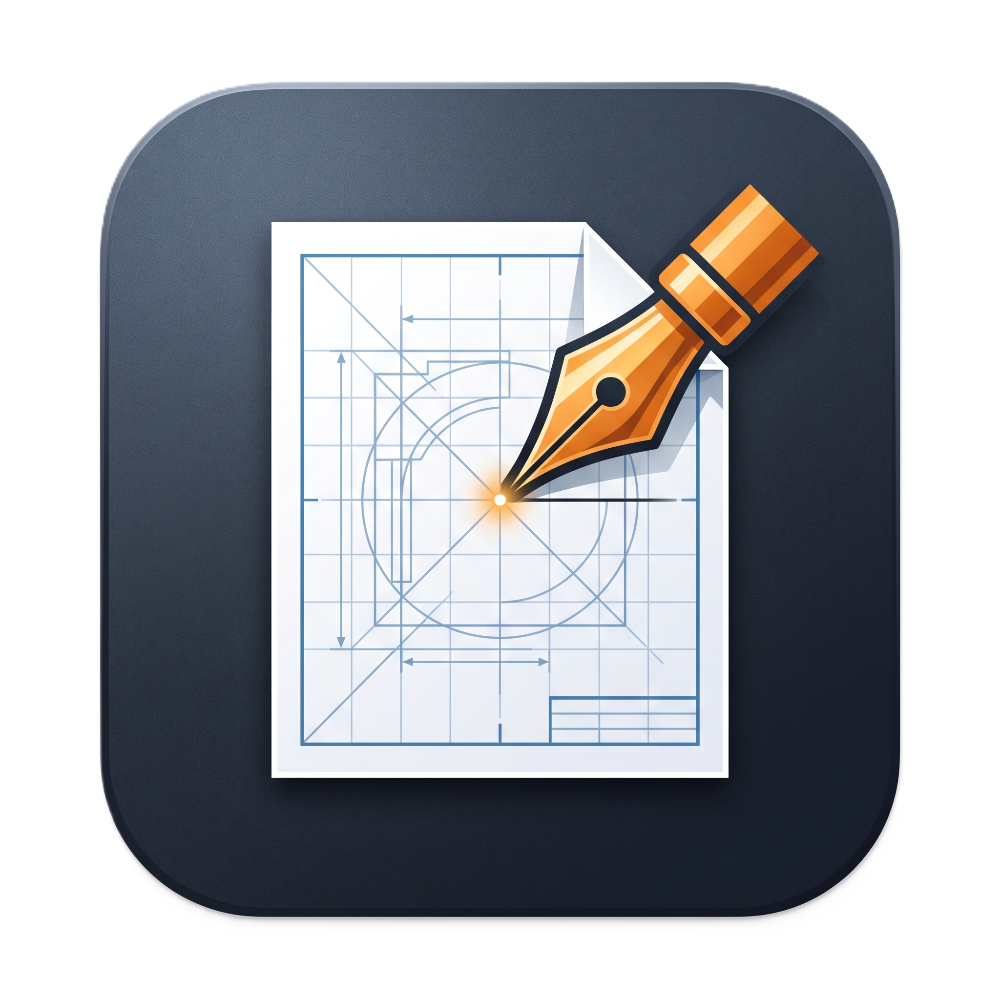

<div align="center">
  
  <h1>PageSmith</h1>
  <p><strong>A fast, portable 64-bit PDF reader and document studio built for heavy engineering drawings and everyday workflows.</strong></p>

  <p>
    <a href="https://github.com/nuruszama/PageSmith/releases/latest">
      
    </a>
    <a href="https://github.com/nuruszama/PageSmith/actions">
      
    </a>
    
  </p>
</div>

---

## Why PageSmith?

Traditional 32-bit PDF viewers and takeoff tools hit memory ceilings and stutter on large multi-page AutoCAD/Revit vector sheets. **PageSmith** is built on a native 64-bit **PyMuPDF + Qt 6 (PySide6)** engine with a hybrid rendering pipeline:

* **Instant 60+ FPS GPU Zoom & Pan:** Smooth `Ctrl + Scroll` zooming with zero UI blocking while dragging across dense A0/A1 drawings.
* **Viewport-Clipped 12x Ultra-HD Rendering:** Automatically rasterizes only the visible viewport region off the main thread at up to **1200% zoom**, keeping small equipment tags and diffuser labels razor-sharp without bloating RAM.
* **Zero Installation (100% Portable):** Single-file executables for **Windows 11 (64-bit)** and **Linux (`x86_64`)** compiled automatically via GitHub Actions—runs directly without admin rights or Python dependencies.
* **Multi-Tab Workspace:** Open multiple drawing sets, schedules, and specifications side-by-side with drag-and-drop and Windows *"Open with"* support.
* **Navigation & Search:** Page thumbnail strip, nested Bookmark / Table of Contents tree, instant view rotation, and full-document text search (`Ctrl + F`).

---

## Download Portable Releases

Grab the latest compiled binaries directly from the **[Releases](https://github.com/nuruszama/PageSmith/releases/latest)** page:

| Platform | Binary | Notes |
| :--- | :--- | :--- |
| **Windows 11 / 10 (64-bit)** | `PageSmith.exe` | Standalone portable `.exe` — double-click or set as default `.pdf` handler |
| **Linux (`x86_64`)** | `PageSmith` | Run `chmod +x PageSmith && ./PageSmith` |

---

## Keyboard Shortcuts

| Action | Shortcut |
| :--- | :--- |
| **Open PDF(s)** | `Ctrl + O` (or drag & drop onto window) |
| **Smooth Zoom In / Out** | `Ctrl + Mouse Wheel` or `Ctrl + +` / `Ctrl + -` |
| **Pan Canvas** | Click & Drag |
| **Next / Previous Page** | `Page Down` / `Page Up` |
| **Find Text** | `Ctrl + F` |

---

## Run from Source (Optional)

If you want to run or modify PageSmith locally:

```bash
git clone [https://github.com/nuruszama/PageSmith.git](https://github.com/nuruszama/PageSmith.git)
cd PageSmith
python -m venv venv

# Windows (PowerShell):
.\venv\Scripts\Activate.ps1
# Linux:
source venv/bin/activate

pip install -r requirements.txt
python main.py
